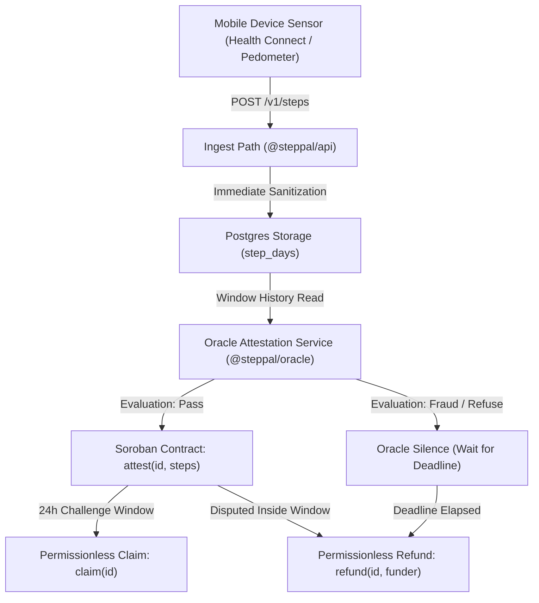

# StepPal Anti-Cheat Threat Model & Oracle Architecture

## Principles

StepPal's commitment protocol is rooted in two core invariants:

1. **A step count is a claim, not a fact.** Mobile hardware sensors report counts; the protocol verifies and decides what to believe.
2. **Funds are never trapped by an oracle.** A silent oracle cannot withhold user funds; after the contract's `deadline`, participants withdraw exact refunds permissionlessly.

---

## Multi-Layer Verification Architecture

### Layer 1: Ingest Path Sanitization (`@steppal/api`)
Applied per write request on `POST /v1/steps`:
- **Future Date Rejection**: Rejects any calendar day ahead of server date.
- **Backfill Window Limitation**: Rejects claims older than 8 days to eliminate late top-ups before settlement.
- **Daily Ingest Clamping**: Steps above `DAILY_STEP_CAP` (25,000) are clamped for pot competition while preserving `raw_steps` for forensic auditing.
- **Idempotency**: Unique constraint on `(user_id, day)` ensures network retries overwrite rather than inflate totals.

### Layer 2: Off-Chain Oracle Evaluation (`@steppal/oracle`)
Operates on the complete multi-day history before settlement:
- **Physical Boundary Verification**: Enforces an absolute physiological maximum of 50,000 steps per calendar day. Flags `IMPLAUSIBLE_STEP_BURST` and `DAILY_CAP_EXCEEDED`.
- **Cross-Day Velocity Spike Analysis**: Flags suspicious step spikes (e.g. jumping from near-zero to peak target right before pot end) and flags submission cadences exceeding human sprint speed (> 4.5 steps/sec).
- **Device Consistency & Sensor Integrity**: Detects suspicious switching between contradictory sensor sources (`mock` mixed with physical sensors) and hardware identifier proliferation.
- **Synthetic Uniformity Detection**: Detects algorithmic bot generators repeating identical numbers with zero natural standard deviation variance.

---

## Smart Contract Interaction & Fallback Invariants

- **`attest(id, steps)`**: Signed by the oracle using `MockSorobanSigner` or `SorobanRpcSigner`, opening the 24-hour challenge window.
- **`dispute(id, challenger)`**: Anyone may dispute during the challenge window, moving the escrow to `Refunding`.
- **Silent Oracle Fallback**: If the oracle refuses to attest due to critical anti-cheat violations, it remains silent. Once `env.ledger().timestamp() >= goal.deadline`, any funder can call `refund(id, funder)` to retrieve their funds.
